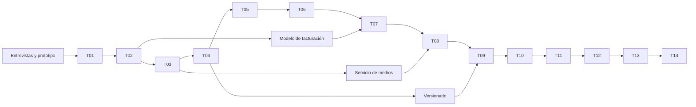

# 02. Hoja de ruta, hitos y dependencias

**Nueva prioridad 24-10-2026:** ejecutar [T17](tandas/17-antropometria-y-densidad-visual.md) antes de aceptar T16 como experiencia final. Primer corte de 401/403 y alineación verificado localmente; siguientes cortes: modelo de evaluación antropométrica, captura ISAK, sumas, estimaciones con fuentes originales, modalidades externas y exportación. [Acta del primer corte](evidencias/t17-primer-corte.md). Los párrafos históricos inferiores no sustituyen esta prioridad.

**T16, 24-10-2026 · entrega local revisable:** [catálogo original y demo privada](evidencias/t16-catalogo-y-prueba.md) preparados. Próximo hito: el titular prueba con las cuentas ficticias los recorridos coach/alumno y registra fallos concretos; luego se comprueba en iPhone/Android físicos antes de decidir alojamiento privado. No iniciar piloto con datos reales solo por esta build. Las notas inferiores son cortes históricos.

**Estado vigente 24-10-2026:** T16 avanzó hasta planes flexibles, correcciones de mediciones y exportación privada; [segundo corte y límites](evidencias/t16-segundo-corte.md). Prioridad para completar T16: licencias y calidad de medios, recorrido autenticado móvil/PC, devolución al padre inmediato y aceptación en iPhone/Android. No abrir piloto con datos reales todavía. El historial de prioridades anteriores sigue debajo.

**Avance T16 24-10-2026:** [primer corte local](evidencias/t16-primer-corte.md) de escala/perfil, menú directo y entrada contextual desde ficha. Próximo corte: resumen/edición/asignación dentro de ficha, retorno en pasos internos y alimentación sin selector de profesional. Sin aceptación visual ni datos reales.

**Prioridad nueva 24-10-2026:** ejecutar por cortes la [T16](tandas/16-ficha-alumno-y-experiencia.md), empezando por escala/perfil, navegación con retorno y ficha con asignación de rutinas existentes. Después editor/catalogación legal, alimentación/mediciones y exportaciones, seguido de validación en teléfonos reales. [ADR 018](decisiones/018-ficha-y-catalogo.md). T15 queda como implementación histórica rechazada visualmente; no hay trabajo T16 ejecutado. El plan y los hitos anteriores de abajo conservan contexto histórico.

**Actualización 24-10-2026:** el usuario reanudó la prueba. Build y revisión local dirigida aprobados; [acta/capturas](evidencias/t15-revision-local.md). Demo encendida; aceptación manual y puertas físicas/externas siguen abiertas.

## Prioridad vigente — 23-10-2026

Cerrar el [rediseño T15](tandas/15-redisenio-mobile-first.md) tras la revisión del usuario: escala compacta, páginas, rutinas por pasos y contenido propio. Código v0.15.0/esquema 024 en local; revisión visual pendiente. App/build apagados por petición del usuario, sin piloto real. Después continuar las puertas de T14. Los hitos y plazos siguientes conservan la planificación original, no son fechas comprometidas ni aceptación del diseño anterior.

## Hitos verificables

| Hito | Tandas | Demostración al cerrar | Decisión de avance |
|---|---|---|---|
| H0 — negocio validado | Descubrimiento previo + T01 | 10 entrevistas, prototipo móvil, presupuesto y entorno restaurable | Existe necesidad pagable y base técnica segura. |
| H1 — organización operativa | T02 | Dos marcas y alumnos aislados; cuenta SaaS visible | Se puede empezar contenido de entrenamiento. |
| H2 — flujo completo de ejercicio | T03–T05 | Coach publica plan y alumno completa sesión con vídeo | Registro usable en teléfonos reales. |
| H3 — piloto cobrable | T06–T07 | Progreso, factura interna trazable, instalación PWA y 3–5 coaches piloto | Activación, retención y soporte justifican ampliar. |
| H4 — superapp de seguimiento | T08–T10 | Archivo/PDF, comida, chat y check-in conectados a alumno | Uso habitual dentro de la plataforma. |
| H5 — gestión comercial | T11–T12 | Reserva, recordatorio, servicios y pagos manuales | Flujo administrativo funciona sin hojas externas. |
| H6 — consolidación y piloto independiente | T13–T14 | Inicio real, navegación simple, firma, flujos/dispositivos, seguridad y recuperación | Coaches independientes pueden entrar en piloto con puertas necesarias cerradas. |

## Dependencias

El orden es la ruta crítica y permite liberar valor sin terminar toda la superapp. Diseño visual, contenido de ejercicios, entrevistas y redacción legal pueden avanzar junto con tandas técnicas. Ninguna tanda con datos privados se despliega sin autorización y prueba de aislamiento.

## Descubrimiento anterior a T01

1. Ejecutar el [plan de validación](10-validacion-y-salida-comercial.md) con al menos 10 coaches de 10–50 alumnos: cómo prescriben, registran, envían vídeos/menús y cobran; cuantificar tiempo perdido y disposición a pagar G. 10.000/G. 15.000 por plaza.
2. Dibujar 5 recorridos en prototipo de 320 y 390 px: alta del coach, invitar alumno, crear rutina, registrar serie, ver progreso. Probar con 3 coaches y 5 alumnos en sus teléfonos.
3. Registrar objeciones y métricas: tiempo de creación de primera rutina, errores de registro, comprensión del precio, frecuencia esperada de uso. Ajustar alcance antes de codificar.
4. Presupuestar VPS, almacenamiento, transferencia, backup, dominio y correo. Definir límites provisionales de medios por plan.

## Ventanas orientativas

Con 2–3 desarrolladores experimentados y acceso a usuarios piloto: H1 en 3–5 semanas; H3 en 3–5 meses acumulados; H4 en 6–9 meses; H6 en 9–15 meses o más. Son hipótesis de calendario, no promesas. La capacidad disponible y las pruebas en dispositivos reales mandan sobre la fecha.

## Corte histórico T14 0.14.1 — 22-10-2026 (ver actualización 0.14.2)

V0.14.1, 001–022; próxima 023. Preparación técnica local ampliada para coaches independientes: configuración/proxy/SW/monitor y medición inicial, más huellas de build y pago/reintento/comprobante WebKit verificados. [Acta inicial](evidencias/t14.md), [continuación](evidencias/t14-continuacion.md), [pasos](runbooks/t14-salida-y-piloto.md), [ficha pendiente](piloto/03-salida-independiente.md). H6 conserva abiertas aceptación física/externa y observación real del piloto. No se inicia multicoach ni nueva tanda por terminar cambios locales. Los cortes siguientes son históricos.

## Seguimiento visible

Usar [criterios de gestión](07-gestion-y-criterios.md) y el [tablero de avances](avances.md). Por tanda: responsable, fecha, tareas, estado, riesgos, evidencia de demo, resultados QA, decisión de avance. No marcar «terminada» una tanda porque solo existan pantallas o migraciones.

### Corte 21-10-2026

T02/T03/T04 implementadas y verificadas en local; T04 acumula 77 pruebas y siete capturas, [acta](evidencias/t04.md). T05 incorpora sesiones idempotentes, cola IndexedDB, shell offline y resultados de alumno/coach; 99 pruebas acumuladas y límites de QA en [acta T05](evidencias/t05.md). T06 añadió progreso/mediciones/fotos privadas, 117 pruebas acumuladas; [acta T06](evidencias/t06.md). T07 tiene base local PWA/cuenta SaaS y operación implementada, 23 unitarias y 73 integraciones aprobadas; repetición final de cuenta WebKit pendiente por recursos y piloto real abierto. [Acta T07](evidencias/t07.md). T08 implementada en local, v0.8.0, con pruebas dirigidas y [acta](evidencias/t08.md). T09 implementada en local (v0.9.0), con [acta y límites](evidencias/t09.md). T10 implementada en local (v0.10.0), con [acta y límites](evidencias/t10.md); T11 implementada en local (v0.11.0), con [acta y límites](evidencias/t11.md); T12 implementada en local (v0.12.0), con [acta y límites](evidencias/t12.md); T13 reorientada e implementada en local (v0.13.0), con [acta y límites](evidencias/t13.md); T14 sigue planificada para piloto independiente. Las puertas externas de T01/T03/T07, teléfonos físicos e investigación con coaches siguen abiertas; este avance local no acredita piloto cobrable ni despliegue.

## Actualización vigente T14-07

V0.14.2/023, próxima 024. Reglas del usuario resueltas e implementadas: admin decide precio mensual/cupo/acceso y coach pago mensual/acceso de alumnos; suspensión del estudio bloquea alumnos, sin automatismos al cambiar de mes. [Entrega y límites](evidencias/t14-control-mensual.md), [guía](runbooks/t14-control-mensual.md). H6 mantiene pendientes físicos/externos, derechos de datos y piloto observado.
