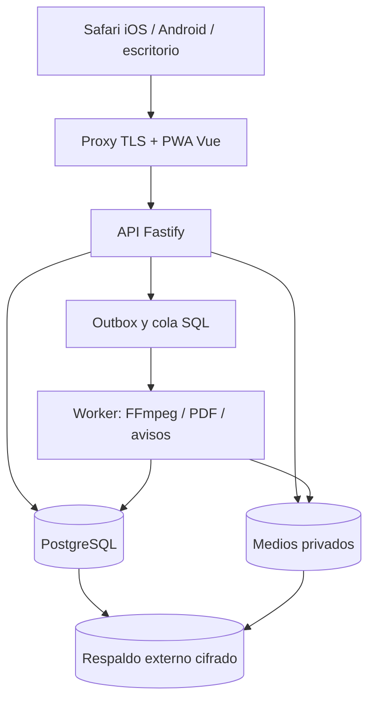

# 03. Arquitectura, datos y revisión del esquema

## Límites del sistema

Monolito modular por dominio: `identity`, `organizations`, `students`, `exercises`, `programs`, `sessions`, `progress`, `media`, `nutrition`, `messages`, `documents`, `scheduling`, `saas-billing`, `coach-billing`, `audit`. Cada dominio posee rutas, casos de uso, consultas y pruebas; los cambios entre dominios pasan por servicios explícitos y eventos persistidos. Nada de microservicios para la primera versión.

## Contratos de API

- `/v1` JSON; DTOs validados en servidor y OpenAPI publicado en staging. Cliente tipado generado en web; errores con código estable, mensaje seguro, `request_id`.
- Recurso siempre resuelto en contexto de organización derivado de dominio/slug y confirmado contra sesión y pertenencia. Un `organization_id` enviado por cliente nunca concede acceso.
- Paginación por cursor para historiales/chat, orden estable, límites máximos, idempotency key en escrituras reintentables.
- Archivos: alta de carga → validación MIME real, tamaño y cuota → almacenamiento privado → procesamiento → recurso listo → URL temporal o streaming autorizado. No exponer claves de almacenamiento.

## Multiempresa y permisos

`app_users` es identidad global; `organizations` representa marca/empresa; `memberships` une personal a empresa; `students` representa alumno por empresa. Un mismo email puede estar en dos empresas, con dos perfiles y datos separados. Tabla de permisos por acción y alcance: propietario, coach asignado, nutricionista asignado, recepción, alumno propio y superadministrador. El superadmin usa rutas separadas y acciones auditadas.

Toda tabla privada tiene `organization_id NOT NULL` y claves foráneas compuestas `(organization_id, recurso_id)` en relaciones entre recursos privados. Los catálogos globales se separan de los privados o utilizan una regla explícita de lectura. RLS se activa como segunda barrera; la API usa rol no propietario y sin `BYPASSRLS`. Cada operación SQL se ejecuta en una transacción que establece el contexto local de organización y usuario; al terminar la transacción se borra el contexto. Se prueban las políticas con el rol real de API. PostgreSQL documenta que el propietario normalmente elude RLS y que `set_config(..., true)` dura la transacción: [RLS](https://www.postgresql.org/docs/18/ddl-rowsecurity.html), [configuración local](https://www.postgresql.org/docs/18/functions-admin.html).

## Integridad histórica

Programas y menús tienen borrador editable y versión publicada inmutable. Asignar apunta a la versión concreta; una sesión guarda lo prescrito y lo ejecutado, sin recalcular historia después de editar plantilla o ejercicio. La publicación y asignación ocurren en transacción. Las tablas de eventos de sesión tienen `client_event_id` único por organización para reintentos de móviles.

## SQL existente: auditoría obligatoria en T01–T02

El archivo [esquema_inicial_coaching.sql](../esquema_inicial_coaching.sql) define 52 tablas, pero es ilustrativo. No usarlo entero como migración inicial. Convertirlo en migraciones pequeñas solo al implementar cada dominio, con estas correcciones previas:

1. Completar RLS con políticas de lectura/escritura por organización, rol y alumno; probar con rol no propietario, sin privilegios indirectos ni superadmin implícito.
2. Sustituir referencias por ID simple donde permiten unir recursos de otra organización (`media_assets`, `exercise_media`, `exercise_equipment`, fotos, adjuntos, documentos y otros). Un catálogo global requiere política explícita.
3. No confiar en `UNIQUE(organization_id,id)` cuando `organization_id` es nullable: valores `NULL` no dan la misma garantía de relación. Separar activos globales o diseñar restricciones verificables.
4. Hacer efectiva la inmutabilidad de versiones publicadas y sus hijos mediante permisos/triggers o servicio con controles de DB; las `ON DELETE CASCADE` del boceto no pueden borrar historial facturado/ejecutado.
5. Evitar intervalos facturables solapados, no solo dos intervalos abiertos; usar exclusión sobre rango o transacción serializada y prueba de concurrencia. Congelar plan, importe y reglas por periodo.
6. Añadir consentimiento, retención, exportación, borrado y acceso a fotografías/datos sensibles antes de esos módulos; archivos requieren ACL propia, no solo pertenecer a la organización.
7. Agregar `created_at`, `updated_at`, índices por organización/fecha, límites de valores y estados coherentes; validar migraciones de ida y recuperación sobre datos de prueba.

## Esquema mínimo por tanda

| Tanda | Entidades principales nuevas |
|---|---|
| 01 | migraciones, logs de auditoría, outbox/trabajos |
| 02 | usuarios, sesiones, organizaciones, membresías, alumnos, invitaciones, marca, planes y suscripciones |
| 03 | ejercicios, equipos, medios y relaciones |
| 04 | programas, versiones, semanas, días, prescripciones, asignaciones |
| 05 | sesiones, ejercicios/series realizadas, eventos idempotentes |
| 06 | mediciones, fotografías (si se habilitan), resúmenes calculados |
| 07 | intervalos, periodos, uso, estados de cuenta, pagos SaaS |
| 08 | carpetas, entradas, comparticiones, documentos generados |
| 09 | alimentos, recetas, versiones de menús, asignaciones y diario |
| 10 | conversaciones, mensajes, adjuntos, formularios, hábitos, notificaciones |
| 11 | calendarios, citas, clases, reservas y reglas de automatización |
| 12 | servicios, contratos/membresías y pagos del coach |
| 13 | sedes, alcance de staff y asignaciones profesionales |
| 14 | ajustes de índices/particiones solo si medición los justifica |

No crear tablas futuras vacías «por adelantado». El SQL debe seguir al caso de uso probado, con migraciones hacia adelante y plan de reversión por despliegue.

## Estado implementado al cerrar T02 local

La migración 002 y el [ADR 002](decisiones/002-organizaciones-y-acceso.md) concretan organización, ficha/identidad, marca, invitación, asignación profesional, planes y uso. Ver [API](runbooks/api-t02.md) y [pruebas](evidencias/t02.md). Los módulos futuros del esquema conceptual siguen pendientes.

## Estado implementado T03 — 21-10-2026

Migraciones 003–005: `exercises`, `equipment`, `media_assets`, `exercise_student_access`, `media_plan_limits` y heartbeat. RLS con permisos por alumno, catálogo global de solo lectura y claves compuestas; cuotas/versiones de plan inmutables. [ADR 003](decisiones/003-biblioteca-y-medios.md) concreta upload a stream, reserva idempotente, estados, jobs con lease y entrega privada con rangos.

Worker FFmpeg/Sharp separado de API/correo: dos slots por proceso y una conversión por organización, límites de tiempo/tamaño y publicación condicionada al lease y permisos actuales. Mantenimiento con retención y bloqueo coordinado con snapshot/copia del backup. Se adoptaron reglas de backend de WaFlow sobre la arquitectura Vue/Fastify/PostgreSQL existente.

Al entrar en T04 se exigió conservar instrucciones/medios históricos y extender el inventario de referencias; el resultado se concreta abajo. [Pruebas T03](evidencias/t03.md).

## Estado implementado T04 — 21-10-2026

Migraciones 006–008: `training_programs`, `program_versions`, `program_version_media`, `program_assignment_batches` y `program_assignments`. Borrador JSONB limitado con revisión; snapshot inmutable, texto/equipo congelados, límites reforzados en DB y medios retenidos por referencia. El snapshot histórico admite 2 MB, el borrador 220 KB de representación DB; la publicación no trunca instrucciones.

La publicación bloquea el programa y es única por revisión. Asignación transaccional e idempotente a una versión exacta, exclusión de periodos solapados por alumno, cancelación con motivo/revisión. RLS limita alumno y profesional; el streaming T03 reconoce permisos de asignación. No se generan sesiones realizadas. [ADR 004](decisiones/004-rutinas-versionadas.md), [API](runbooks/api-t04.md), [acta](evidencias/t04.md).

Backup/restauración incluyen el inventario ampliado y conteos de programas/versiones/asignaciones. T05 empieza desde migración 009 y debe conservar la relación asignación/versión/semana/día/ejercicio/serie al añadir ejecución real e idempotencia de eventos.

## Implementación T05 — sesiones y cola local

Migraciones 009/010: `workout_sessions`, `workout_sets`, `workout_events` y `workout_session_media`. Una sesión por día de asignación, prescripción histórica inmutable, campos realizados separados, recibos idempotentes y revisiones por serie/notas/sesión. Escritura mediante funciones acotadas y lectura RLS para alumno propio/coach autorizado. El detalle toma bloqueo compartido autorizado para no mezclar revisiones.

IndexedDB guarda cada intención antes de red y conserva pendientes ante fallos/conflictos/cancelación. El shell compilado precarga solo recursos públicos; API y medios privados requieren autorización y no entran en CacheStorage. Contexto offline del alumno de 24 horas; cierre de sesión purga cuenta y difiere revocación si no hay red. [ADR 005](decisiones/005-sesiones-y-sincronizacion.md) y [API T05](runbooks/api-t05.md).

Backup/restauración añade conteos de sesiones/series/eventos y conserva referencias históricas de medios. T06 debe calcular métricas desde hechos confirmados, nunca desde intenciones locales pendientes.

## Implementación T06 — progreso y privacidad

Migraciones 011–013: mediciones inmutables con anulación auditada, consentimiento/revisión, permisos separados por profesional, fotos privadas y avisos de inactividad. Métricas agregadas desde sesiones finalizadas/series registradas, con fechas DATE para planificación y zona explícita para cierre/alta. Cumplimiento por fecha distinta y cancelaciones visibles. Historial carga sesiones/series/medios por lote.

Fotos fuera de `media_assets`: acceso propio/compartición explícita, consentimiento maestro y revocación en servidor. Sharp asíncrono acotado normaliza y genera miniatura, elimina EXIF y descarta original; cuota conjunta con medios/logos. Mantenimiento retira bytes después de 30 días, coordinado con backup; restauración verifica 13 conteos e inventario privado. No se añade almacenamiento offline de mediciones/fotos. [ADR 006](decisiones/006-progreso-y-privacidad.md), [API T06](runbooks/api-t06.md), [uso](runbooks/t06-uso-y-operacion.md). La siguiente migración empieza en 014.

## Implementación T07 — PWA y cuenta SaaS

Migraciones 014–016: habilitación con activación transaccional, cuentas/snapshots inmutables, ajustes, pagos/reversiones, comprobantes privados y resumen agregado. Cálculo SQL por calendario local y días distintos; control de cierre/cupo monetario/concurrencia. Lectura financiera owner/superadmin, incluida consulta de cuenta suspendida sin reabrir entrenamiento.

PWA: manifest/iconos públicos por estudio, arranque explícito y worker en espera hasta cerrar ventanas. Hash del shell incorpora todos los recursos públicos, sin cachear API/medios/recibos. CLI operativo y backup con identidad DB/storage y 23 indicadores; restauración también contrasta saldos autorizados. [ADR 007](decisiones/007-pwa-y-cuenta-saas.md), [API](runbooks/api-t07.md), [acta](evidencias/t07.md). Siguiente migración 017; despliegue/piloto externo pendientes.

## Implementación T08 — Recursos y documentos

Migración 017: colecciones, recursos/versiones, concesiones, tickets temporales y heartbeat documental. Claves compuestas, RLS y escrituras acotadas; creador/owner y alumno explícito. Relacionar ficha/programa no comparte. Worker secuencial y tres plantillas con snapshot/marca; PDF externo en cuarentena con ClamAV, medios T03 sin copiar bytes.

Entrega temporal HttpOnly por usuario/archivo y permiso revalidado. Inventario y retención coordinados con backup; código amplía a 27 indicadores, sin nueva restauración. [ADR](decisiones/008-recursos-y-pdf.md), [API](runbooks/api-t08.md), [acta](evidencias/t08.md). Siguiente migración 018; 017 queda inmutable.

## Implementación T09 — Alimentación

Migración 018 y API `/nutrition`, sin dependencias nuevas. Nueve tablas: capacidad profesional, catálogo tipado food/recipe/menu, versiones de menú, asignaciones, preferencias, concesiones, registros, comentarios y fotos. Funciones SQL validan alcance/referencias y construyen snapshots; RLS y API sin DML directo. Exclusión temporal de asignaciones activas, publicación congelada, revisiones e idempotencia. Catálogo con fuente/preparación por 100 g y desconocidos nullable; no catálogo externo automático.

Diario/fotos tienen consentimiento propio, sin acceso implícito del owner. Motor PDF T08 despacha `forma-menu-v1` conservando `forma-docs-v1`; cola/cuota/archivo privado compartidos. Fotos incorporadas al inventario y cuota; backup suma nueve conteos (36 indicadores previstos), sin ensayo nuevo. [ADR 009](decisiones/009-alimentacion-versionada.md), [API](runbooks/api-t09.md). Siguiente migración 019.

## Ampliación T10 — Chat y seguimiento

Migración 019: trece tablas de dominio `followup_*` más heartbeat operativo. Parejas privadas por organización/alumno/profesional, secuencias transaccionales, recibos por UUID/hash, RLS y funciones acotadas. WebSocket solo invalida después del commit; HTTP vuelve a autorizar contenido. Seguimiento tiene consentimiento propio; archivos usan cuota e inventario compartidos y se excluyen de la biblioteca. Formularios publicados congelados, programación semanal/mensual, CAS y revisión.

[ADR 010](decisiones/010-chat-y-seguimiento-privados.md), [contrato](runbooks/api-t10.md), [operación](runbooks/t10-uso-y-operacion.md). Backup añade trece conteos (49 indicadores previstos); no se ensayó otra restauración. T11 continúa en 020 sin ampliar de forma implícita la privacidad de conversaciones.

## Ampliación implementada T11 — Agenda

V0.11.0 / migración 020. Diez tablas de dominio: agenda_availability, agenda_events, agenda_bookings, agenda_commands, agenda_rules, agenda_rule_versions, agenda_outbox, agenda_runs, agenda_preferences y agenda_notifications. agenda_worker_state conserva latido operativo. RLS forzada y funciones controladas; API no ejecuta funciones internas.

UTC y zona IANA de organización, intervalos [inicio, fin), exclusión GiST global por profesional/usuario alumno y bloqueos ordenados para cupo/edición. Outbox transaccional, versiones inmutables, recibos de intención y entrega con lease/deduplicación. El owner gestiona agenda sin adquirir lectura de chat. Preferencias/silencio/límite/vínculos se revalidan al entregar; worker T10 compartido, sin servicio nuevo. [ADR completo](decisiones/011-agenda-y-avisos-internos.md), [API](runbooks/api-t11.md). Siguiente migración 021; nunca reescribir 020 aplicada. Backup: 59 indicadores previstos; recuperación pendiente.

## Ampliación implementada T12 — Comercio del coach

V0.12.0 / 021. Diez tablas coach_services/contracts/charges/adjustments/payments/refunds/session_entries/prospects/prospect_events/commands. Sin FK comercial a saas_invoices/saas_payments. RLS y funciones controladas: owner gestiona, alumno lee lo propio; staff no hereda acceso comercial.

Snapshot inmutable del servicio vendido, 1–24 cuotas y ledger append-only. Enteros de unidad mínima; reportes agregados como cadenas/BigInt por moneda. Recibos de intención y bloqueo por organización serializan saldo/cupo. Paquetes usan asistencia T11 explícita sin descuento por reserva. CRM convierte por correo y redacciona cerrados a 90 días en worker existente. Comprobantes WebP privados y referencias de backup incorporadas; 81 indicadores previstos. [ADR](decisiones/012-negocio-del-coach.md), [contratos](runbooks/api-t12.md). Próxima migración 022.

## T13 — Alcance independiente y resumen de inicio

022 conserva esquema/RLS/roles anteriores y añade guard de altas solo coach, constructor previo interno y coach_start_overview owner-only. Agregados por tenant sin contenido privado; sin tablas, cuotas o archivos nuevos. Backup sigue en 81 indicadores previstos. La plataforma mantiene múltiples coaches aislados; colaboración/sedes quedan fuera del producto actual. [ADR 013](decisiones/013-coaches-independientes.md), [API](runbooks/api-t13.md). Próxima migración 023.
