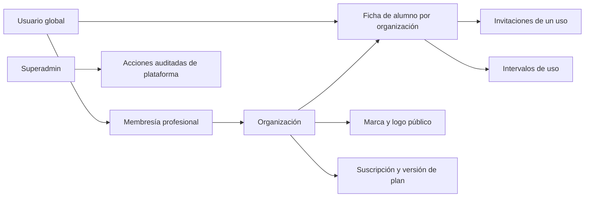

# ADR 002 — Organización, identidad y uso de plazas

**Estado:** implementado y probado en local. **Fecha:** 20-10-2026. **Complementa:** ADR 001; no cierra sus puertas externas.

## Decisión

Mantener Vue/Pinia en cliente, Fastify en API y PostgreSQL para datos y transacciones. `002_organizations.sql` añade la separación entre identidad global, organización, membresía profesional y ficha de alumno. Una identidad puede tener varias membresías/fichas; no se duplican credenciales por coach.

## Autorización

- La sesión se resuelve antes de establecer contexto. La URL/UUID no acredita pertenencia.
- `actorTransaction` configura usuario/organización con `set_config(..., true)` dentro de la transacción y devuelve la conexión al pool después de commit/rollback.
- RLS con FORCE protege las tablas de tenant. Las políticas comprueban membresía, estado del estudio y asignación/identidad del alumno; sin contexto no se leen filas privadas.
- Funciones SQL limitadas y parametrizadas implementan transiciones y operaciones que necesitan mirar varias tablas. Usan `SECURITY DEFINER`, nombres de tabla cualificados, `search_path` fijo y permisos EXECUTE revocados a PUBLIC. El rol API no puede cambiar estados facturables ni `is_superadmin` mediante UPDATE directo.
- Un superadmin tiene un circuito separado para organizaciones, planes y suspensión, con auditoría. No equivale a un coach miembro de todas las organizaciones.
- Slug/host dan contexto de marca. El endpoint público de marca/logo expone solo la identidad publicada; todo recurso de alumno requiere autorización.

RLS no protege frente al administrador de PostgreSQL ni frente a quien controle por completo el proceso API y pueda suplantar el contexto. Es una segunda barrera frente a errores de consultas, junto con la comprobación de sesión y permisos en cada endpoint. [Comportamiento oficial de RLS](https://www.postgresql.org/docs/current/ddl-rowsecurity.html).

## Activación y concurrencia

Las operaciones que consumen cupo bloquean primero la organización y después la ficha/invitación. Verifican cupo, vinculación de cuenta y estado de suscripción dentro de la misma transacción. Una exclusión GiST sobre organización/ficha/rango impide intervalos solapados. Los reintentos con el mismo estado son idempotentes; otro cambio con una versión vieja falla con conflicto.

Se evita usar «número de profesionales» como unidad de uso. Una ficha activa ocupa una plaza, aunque tenga dos profesionales asignados. El cálculo monetario y el prorrateo quedan en T07, partiendo de estos intervalos.

## Marca y datos locales

La base guarda nombre/color/perfil; el almacenamiento guarda logos con claves opacas y referencia compuesta por organización. Sharp valida el formato real, limita bytes/píxeles y crea una salida WebP de tamaño acotado. No se permite SVG disfrazado de PNG. [Constructor y límite de píxeles](https://sharp.pixelplumbing.com/api-constructor/), [metadatos del formato](https://sharp.pixelplumbing.com/api-input/).

`localStorage` queda para la demostración explícita. El modo real guarda en servidor; `sessionStorage` solo recuerda modo y UUID seleccionado, nunca el token de sesión ni las fichas.

## Consecuencias y trabajos posteriores

- Se conserva historial al pausar/archivar. Borrado/exportación y retención requieren el proceso previo al piloto.
- Las versiones de plan no se actualizan: se insertan versiones nuevas y se registra el cambio de referencia.
- El correo usa cola existente con tres plantillas. Su disponibilidad no se simula: la UI distingue trabajo en cola de recepción.
- La lista de alumnos usa cursor estable y páginas de hasta 100; la UI carga de 50 en 50. El contador total del plan viene del servidor, no del tamaño de una página.
- El listado SaaS administrativo todavía se carga completo; paginarlo antes de incorporar muchas organizaciones (T14).
- La administración gráfica del equipo pertenece a T13. Las restricciones de asignación están implementadas y probadas ahora.
- T03 debe limpiar archivos huérfanos/antiguos y añadir cuotas globales de medios. T02 limita cada logo, no el almacenamiento acumulado por versiones.
- `btree_gist` debe estar disponible en el servidor PostgreSQL. No modificar la migración 002 una vez aplicada: introducir 003 para cualquier cambio posterior del esquema.

## Actualización de alcance T13

La decisión vigente limita el producto a coaches independientes. Cualquier referencia previa a equipos, sedes, recepción o grupos formales como entrega T13 queda sustituida por [consolidación individual](../tandas/13-gimnasios.md); [multicoach se aplaza](../pendientes/gimnasios-futuro.md) fuera de las tandas actuales.

