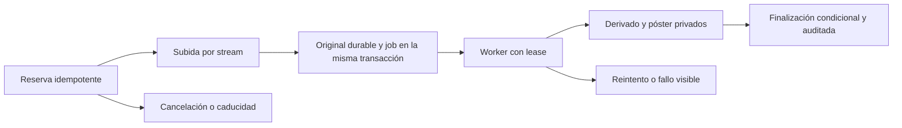

# ADR 003 — Biblioteca privada y procesamiento de medios

**Fecha:** 21-10-2026. **Estado:** implementado y verificado localmente; aceptación física de vídeo pendiente según [acta T03](../evidencias/t03.md). Arquitectura vigente: Vue/Pinia + Fastify + PostgreSQL, con worker de medios independiente.

## Reglas tomadas de WaFlow

Se revisaron como referencias los proyectos paralelos, sin modificarlos ni reutilizar sus servicios externos:

1. WaFlow v1: `C:/Users/info/Documents/Waflow-Frontend/wa-v1-api/docs/redis-workers.md` y `PLAN_FINAL_ESTABILIDAD_WAFLOW_V1.md`: separar recepción HTTP de trabajo pesado, dueño explícito, límites de concurrencia, salud funcional y estados honestos.
2. WaFlow Frappe: `C:/Users/info/Documents/Waflow-Frontend/whatsapp-automation/docs/frappe-migration/backend-hardening/03-contratos-de-mensajeria-medios-y-automatizaciones.md` y `04-plan-de-endurecimiento.md`: intención durable, reserva atómica, idempotencia, lease que impide finalizar desde un intento viejo, revalidación de permisos y límites de recursos.
3. Frappe spike README y pruebas de endurecimiento: un estado local o de simulación nunca acredita entrega o procesamiento real.

Se conservan PostgreSQL y su cola existente: la reserva, el medio y el trabajo se confirman transaccionalmente en la misma base. Esta tanda no necesita introducir Redis, Frappe ni integraciones de mensajería. Se mantienen las exclusiones de IA y pagos variables a terceros del proyecto.

## Modelo y permisos

- `exercises`: catálogo base global de solo lectura y ejercicios propios por organización, con instrucciones, músculo, tipo de registro, variantes, etiquetas, estado y versión.
- `equipment`: equipo del estudio, foto, ubicación, disponibilidad/mantenimiento/archivo y versión.
- `media_assets`: identidad de subida, tamaño reservado, original, derivados, hashes, estado, versión de operación, error seguro y métricas.
- `exercise_student_access`: permiso explícito de una guía publicada para una ficha de alumno. Es un acceso a material educativo, no una asignación de programa de T04.
- `media_plan_limits`: cuotas asociadas a una versión inmutable de plan. Cambiar condiciones requiere una versión nueva y su fila de límites.
- `media_worker_heartbeats`: señal de disponibilidad, motor y actividad del procesador.

RLS se aplica también a consultas directas del rol API. Las referencias de equipo/medio/ejercicio/alumno contienen `organization_id`; no se puede vincular el archivo de otro estudio usando su UUID. El catálogo global no puede editarse desde el rol API. Owner/coach gestionan la biblioteca compartida del estudio; el coach solo comparte con alumnos que puede gestionar. El alumno activo ve catálogo base y guías publicadas compartidas con su ficha.

El original no tiene endpoint de descarga. La API devuelve únicamente URLs de derivados, nunca claves del almacenamiento, rutas del equipo ni hashes internos. El logo de T02 sigue siendo un recurso público deliberado: sus endpoints no se reutilizan para esta biblioteca.

## Subida y cuota

La reserva bloquea la organización y comprueba el plan, el espacio, los minutos y los cuatro puestos de carga pendientes. El mismo `requestId` con el mismo contenido declarado devuelve la misma reserva; cambiar sus datos devuelve conflicto. Los bytes recibidos deben coincidir exactamente con lo reservado. Los archivos incompletos se retiran; una recepción caduca a los 30 minutos y la conexión de subida tiene timeout de 60 segundos.

Se reserva el original más el máximo de salida antes de recibirlo: imagen + 2 MiB; vídeo + 24,5 MiB. Al terminar se contabilizan bytes reales de original, salida y póster. Se incluyen las versiones de logos. Los medios retirados siguen consumiendo su espacio físico hasta la pasada de limpieza. El original se conserva para permitir reintentos, pero permanece privado.

| Límite | Básico v1 | Pro v1 |
|---|---|---|
| Almacenamiento | 512 MiB | 2 GiB |
| Vídeo conservado/reservado | 30 minutos | 120 minutos |
| Cargas pendientes por estudio | 4 | 4 |
| Imagen de entrada | 5 MiB / 12 megapíxeles | Igual |
| Vídeo de entrada | 20 MiB / 60 s / 8 megapíxeles / lado máximo 4096 px | Igual |

Los minutos pendientes reservan 60 segundos por clip hasta conocer su duración. No se permite crear cargas o reintentos nuevos con trial/suscripción vencida. Se permite consultar material ya autorizado mientras la política comercial de T07 no suspenda ese acceso.

## Conversión y propiedad del trabajo

El worker inicial es un proceso con dos slots y, como máximo, una conversión por organización. El reclamo usa `SKIP LOCKED` y un bloqueo asesor de organización para evitar que dos procesos reclamen simultáneamente dos trabajos del mismo estudio. No desplegar más réplicas sin revisar el límite global de capacidad.

Cada intento tiene token de lease y vence a los dos minutos; el dueño lo renueva cada diez segundos. El inicio y la finalización revalidan organización y membresía/usuario del creador. La finalización cambia medio y job en una transacción condicionada al lease actual. Un worker viejo, una cancelación o una versión sustituida no pueden publicar un resultado atrasado.

- Hasta tres intentos automáticos con backoff; hasta tres versiones de operación por reintento manual.
- Imagen: Sharp comprueba el formato real, limita píxeles, normaliza orientación y produce WebP de hasta 1600 px y 2 MiB. GIF se convierte en imagen estática del primer fotograma.
- Vídeo: se comprueba firma y metadatos reales; FFprobe admite solo contenedores MP4/MOV/WebM con un flujo de vídeo. FFmpeg genera MP4 H.264 Main nivel 3.1, YUV420p, hasta 1280 × 720 y 30 fps, audio AAC si existe y `faststart`; póster JPEG de hasta 640 px.
- No se importan URLs. Los subprocesos reciben argumentos, sin shell, y protocolos restringidos a archivos locales/pipe. Se limita tiempo de sondeo, conversión, póster, salida y logs del proceso.
- La API no transcodifica. El worker de correo solo reclama correo; no consume trabajos de medios.
- Los procesos forzados se esperan hasta su cierre para poder retirar temporales en Windows. Una segunda cota de terminación evita una espera indefinida.
- Compose reserva 2 CPU, 768 MiB de RAM, 64 procesos y 128 MiB temporales para el worker. La ejecución real de esos contenedores continúa como puerta externa pendiente.

## Reproducción privada

Cada GET/HEAD/Range vuelve a resolver sesión, organización y permiso del alumno. El endpoint soporta rangos simples y devuelve 206/416 según corresponda; usa `Cache-Control: private, no-store`. Ni conocer una URL ni conservarla después de retirar el acceso permite otra descarga.

El reproductor usa `playsinline`, controles nativos, póster y metadatos. Si el motor nativo no envía cookies o falla, se intenta una descarga con credenciales de la misma sesión hacia un Blob temporal de hasta 25 MiB. Se libera su URL al cerrar el diálogo. No se crea un enlace público ni se guarda el vídeo en `localStorage` o en un service worker. Los bytes ya descargados no pueden retirarse del dispositivo de forma remota.

Si también falla ese intento, permanecen las instrucciones de texto. Los resultados de reproducción por motor y las limitaciones de emulación se consignan en el acta: [Playwright sobre diferencias de medios entre sistemas](https://github.com/microsoft/playwright/blob/main/docs/src/browsers.md).

En desarrollo se bloquean `.local`, storage, backups y archivos sensibles en el acceso de archivos de Vite; la descarga autorizada de la API es el único camino para medios privados. [Configuración oficial de Vite](https://vite.dev/config/server-options#server-fs-deny).

## Recuperación y limpieza

Cada minuto se cancelan reservas caducadas, se reconcilian leases agotados y se retiran archivos de medios eliminados/cancelados tras un minuto. Se eliminan logos sin referencia de más de siete días. La pasada de huérfanos considera solo nombres opacos conocidos, sin enlaces simbólicos, de más de 24 horas. Los temporales conocidos de conversión de más de una hora también se limpian. No se hace borrado recursivo de directorios arbitrarios.

Los archivos sin referencia que no se pueden retirar se reintentan mediante la pasada posterior de huérfanos. Antes del piloto deben existir alertas de disco y backup externo. En T08 se extenderá el inventario de referencias al incorporar nuevos tipos de archivos.

Migraciones: 003 crea el módulo; 004 concede USAGE del esquema al worker sin darle lectura directa de tablas privadas; 005 revalida permisos al terminar y congela los límites por versión de plan. No reescribir ninguna migración aplicada.

El backup y el mantenimiento se coordinan con un bloqueo asesor por base: compartido durante snapshot/copia y exclusivo durante limpieza. `pg_dump --snapshot` usa la misma instantánea que los conteos y referencias; se empaqueta una copia de archivos finalizados y se rechaza la ausencia de cualquier referencia. La restauración vuelve a contrastar referencias además de hashes. Las suites de integración usan bases y storage aislados para no mezclar archivos temporales con el estudio local.
