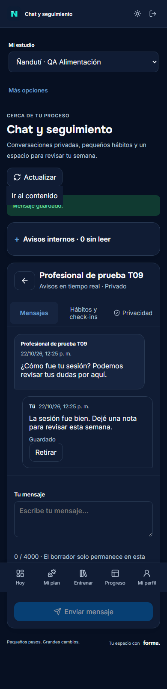
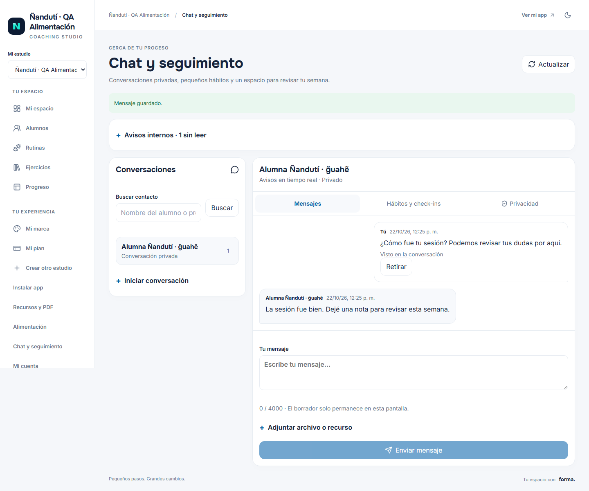
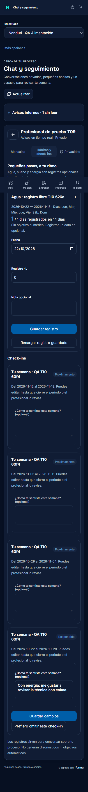

# Acta T10 — Chat, hábitos y check-ins

**22-10-2026 · v0.10.0 · local Windows/PostgreSQL 16.** Migración 019 aplicada; siguiente 020. Implementación local, sin despliegue ni piloto real. Fixtures ficticios `example.test`.

## Entregado

- `/seguimiento` en Más opciones/sidebar, con lista y conversación móvil o dos columnas PC. Mensajes ordenados e idempotentes, paginación, marcas de lectura, retirada del autor y retención técnica.
- Parejas privadas alumno/profesional vinculado. El owner no accede por su cargo a chats de otro profesional. WebSocket autenticado/origen, invalidación tras commit, revalidación y reconexión/HTTP alternativo visible.
- Imagen/vídeo/audio normalizados, PDF condicionado a scanner real, cuota e inventario compartidos. Biblioteca protege medios de chat; recurso T08 se acepta solo si lo creó ese profesional y ya estaba compartido, con revalidación al descargar.
- Bandeja y preferencias internas, silenciar y avisos de mensaje/check-in/revisión deduplicados por conversación. Push opcional sin habilitar; ningún envío externo.
- Hábitos con frecuencia/snapshot, agua/sueño/energía opcionales y consentimiento propio por conversación. Cero, ausencia y referencia opcional diferenciados.
- Borrador/versiones de formularios, campos tipados y adjuntos, semana/mes con ajuste de último día, respuesta editable en ventana, omisión voluntaria y revisión que cierra edición.
- Programador ligero de lotes, heartbeat y Compose; medios con concurrencia 1 por defecto. Backup añade 13 conteos: **49 indicadores previstos**, sin otra restauración.

## Verificación realizada

| Área | Resultado y alcance |
|---|---|
| SQL | Comprobación de sintaxis en transacción revertida; 019 aplicada después de las verificaciones en bases aisladas. Se preservan checksums 001–018 |
| Integración nueva | **11 casos únicos aprobados**, sumando la ejecución inicial y filtros afectados; no se afirma una ejecución completa final de todas las suites. [Resumen verificable](t10-pruebas.json) |
| Unitarias nuevas | **3 aprobadas**: calendario mensual/semanal, cero/false y validación, progreso sin convertir ausencia en cero ni inventar objetivo |
| Privacidad | Otro tenant/alumno/profesional y owner de chat ajeno bloqueados, RLS y helpers sin EXECUTE, biblioteca no lee el medio privado |
| Tiempo real | Socket con sesión, invalidación después de envío persistido y cierre tras revocar vínculo; HTTP devuelve el mensaje una vez. Reconexión física y sesión prolongada siguen pendientes |
| Medios | Una imagen de 12×12 px y un audio/vídeo sintético de **0,2 segundos** procesados secuencialmente. Lectura privada/rango, retirada y referencia T08 revocada comprobadas. PDF sin scanner bloqueado |
| Seguimiento | Permiso separado, null/0, CAS/reintento, snapshot publicado inmutable, false/0 en respuestas, revisión y cierre, aviso repetido sin duplicación y respuesta tardía rechazada |
| Build/tipos | Vue/TypeScript y build Vite aprobados; shell público de 59 assets, sin API/medios privados. Refinamiento móvil posterior de orden/tarjetas con tipos Vue y recompilación aprobados |
| Lint/formato | Archivos de código cambiados revisados; sin lint global de suites históricas |
| Documentación | 622 enlaces locales comprobados, ninguno roto; versiones internas y lockfile alineados en 0.10.0 |
| UI observada | Chat en dos contextos, aviso WebSocket, creación de hábito sin referencia, formulario guardado/publicado/programado, alumno registra cero y responde. Revisión enviada desde UI y persistencia confirmada por consulta de solo lectura |
| Reflujo | Chat observado en **320/390/768/1440 px**; seguimiento también a 320. Inputs visibles ≥16 px, navegación principal ≤5; capturas móvil oscuro/PC claro revisadas |
| Navegador y presupuesto | **4 procesos Chromium secuenciales**, inicial y continuaciones acotadas (58,5 s sumados), sin trazas/vídeos/PDF ni reconstrucción de flujos ya confirmados. Los selectores del script fueron ambiguos o desaparecieron al cambiar Enviar→Guardar cambios y al cerrar revisión. Se detuvieron nuevas repeticiones; la comprobación final de guardado fue de solo lectura |
| Recuperación | Inventario y conteos ampliados. **No se ejecutaron backup/restore, Docker, antivirus real, WebKit ni matriz histórica** |

El [informe visual](t10-visual.json) conserva el estado **observación parcial confirmada**, no un `passed` de navegador completo. Se preservan [primer intento](t10-visual-inicial.json), [constructor](t10-visual-construccion.json), [respuesta](t10-visual-respuesta.json) y [revisión](t10-visual-revision.json). Esos fallos de localizador no se cuentan como pruebas aprobadas; las acciones persistidas se distinguen de las aserciones del recorrido. No se llegó al tramo opcional de desconexión del navegador; el contrato de servidor sí está cubierto por integración y la aceptación física permanece abierta.

### Casos nuevos de integración

1. Privacidad de pareja, owner sin bypass, otro alumno/tenant y RLS/helper privado.
2. Orden concurrente, reintento exacto, conflicto de intención, páginas y lectura monotónica.
3. Avisos de dos conversaciones sin colisión y preferencias sin perder mensajes.
4. WebSocket con sesión, mensaje persistido y revocación del vínculo.
5. Imagen privada del alumno, normalización, biblioteca bloqueada, rango y retirada sin resurrección.
6. Consentimiento de seguimiento, null/0, CAS y retirada del acceso profesional.
7. Publicación inmutable, false/0, respuesta idempotente y revisión que cierra edición.
8. Programador repetido, aviso único, omisión sin consentimiento y respuesta fuera de fecha.
9. Retención, PDF sin scanner y privilegios mínimos.
10. Recurso T08 explícitamente compartido, otro profesional rechazado y descarga revocada.
11. Audio/vídeo muy pequeños, normalización y cuota compartida.

Hubo un fallo inicial de fixture antes de ejecutar casos (alias de fecha), corregido. La primera pasada funcional aprobó siete de nueve; se diagnosticaron solo los dos check-ins con alias SQL ambiguo. Tras corregirlo pasaron ambos y el caso de audio/vídeo. El fixture de recurso mezclaba integer/bigint; se corrigió y se repitió solo ese caso. No se reejecutaron los siete ya aprobados.

## Capturas

### Chat móvil — tema oscuro

### Chat en PC — tema claro

### Hábitos y respuesta móvil

La captura de seguimiento precede al ajuste final que prioriza tareas disponibles/respondidas y compacta las futuras sin mostrar sus campos antes de tiempo. No se regeneró la captura por ese refinamiento para respetar el presupuesto. El teclado físico y la posición durante scroll requieren comprobación en teléfono; una captura full-page no la acredita.

## Puertas abiertas

- Dos teléfonos reales, Safari y app instalada, teclado, safe areas, reanudación de red/suspensión, formatos nativos, lector de pantalla y zoom real.
- Pendiente final WebKit de T07; no se reabrió su suite.
- Push web opcional, HTTPS/proxy WebSocket, alertas y operación del programador en despliegue.
- ClamAV real y visor PDF nativo; el fallo cerrado local no sustituye escaneo real.
- Condiciones/finalidad/retención definitivas y revisión profesional donde corresponda.
- Backup externo y restauración T08–T10 con inventario/49 indicadores, permisos y revocaciones.
- Piloto, entrevistas y costes reales anteriores.

## Documentación y continuación

[Manual detallado](../runbooks/t10-uso-y-operacion.md), [API](../runbooks/api-t10.md), [ADR 010](../decisiones/010-chat-y-seguimiento-privados.md), [tanda](../tandas/10-chat-habitos.md), [avances](../avances.md) y [plan visual](../11-plan-visual.md). T11 recibe 0.10.0 y siguiente migración 020. La [firma NAVZ](../pendientes/firma-navz.md) está documentada como pendiente para más adelante y todavía no se añadió a la interfaz.
