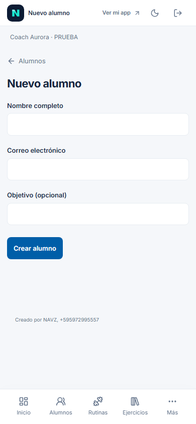
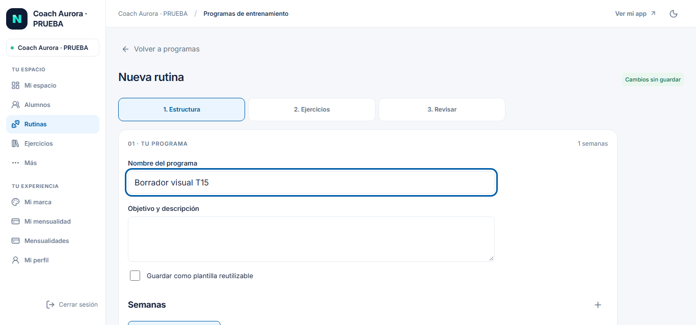

# T15 — Reanudación de la prueba local

**24-10-2026 · v0.15.0 · esquema 024, sin nueva migración.** El usuario pidió volver a probar. Esta entrada actualiza la pausa del [acta anterior](t15-redisenio.md); la aceptación del usuario y los ensayos físicos siguen abiertos.

## Ejecución y correcciones

1. Una compilación completa del estado vigente, incluidos tipos frontend/servidor: aprobada. Shell de 85 assets, 86 artefactos y huella de 146 fuentes.
2. Demo existente arrancada sin reset, siembra o migraciones adicionales. El primer intento de entrada falló porque PostgreSQL local estaba detenido; la pantalla de instalación sí se había comprobado. [Informe inicial](t15-ui-review-initial.json).
3. Se comprobó el servicio local y se encendió PostgreSQL conservando las bases. Se retomó el recorrido **desde el acceso**, sin repetir la bienvenida. [Informe del recorrido](t15-ui-review.json), 3,137 s de esa ejecución.
4. En las capturas se detectaron el botón Atrás con apariencia nativa y la condición `startsWith('/alumno')`, que también coincidía con `/alumnos`. Corregidos el estilo y la detección de ruta. Se quitó el enlace Más duplicado en el encabezado móvil y se dirigió Mi mensualidad a `/cuenta`.
5. Solo estos ajustes de frontend necesitaron otro empaquetado Vite/shell, 2,21 s de Vite; no se repitió la comprobación completa de tipos ni el recorrido funcional. [Verificación de los detalles corregidos](t15-ui-polish.json), 2,971 s y una captura final.
6. Tres instancias Chromium en total: primer intento interrumpido por base apagada, recorrido retomado y revisión exclusiva de los detalles observados. Tres capturas generadas: móvil inicial, PC y móvil final. Sin suites históricas, nuevas dependencias, worker, PDF, correo, restauración o datos de negocio creados por las pruebas.

## Qué se comprobó

- Primera pantalla móvil de instalación y continuación en navegador; no instalación nativa real.
- Entrada de Coach Aurora mediante el formulario.
- Nuevo alumno como página: objetivo vacío, cero elementos `dialog`, campos de 16 px y sin desborde horizontal a 390 y 320 px.
- Cancelar la salida conserva lo escrito; confirmar sale sin crear la ficha.
- Rutina en PC 1366 × 638: un paso visible, cero paneles del constructor con scroll vertical interno y acciones de posición estática.
- Desde Ejercicios se abre Crear ejercicio y añadirlo con categoría y unidad inicialmente vacías. Volver conserva el nombre del borrador de rutina. **No se guardó el ejercicio ni se publicó una rutina en esta revisión.**
- Cero errores JavaScript registrados en el recorrido funcional. Las dos capturas de pantallas y la móvil final se inspeccionaron visualmente.
- Encabezado de Alumnos conserva vista coach, retorno sin borde nativo, Más sin duplicado y enlace de cuenta mensual correcto.

## Capturas inspeccionadas

La [captura móvil inicial](t15-mobile-initial.png) conserva el defecto de retorno/encabezado observado antes de corregirlo.

## Estado al entregar

Demo **encendida para la prueba manual del usuario**, solo en este PC: http://127.0.0.1:4180/acceso. API 3010, PostgreSQL local 54329. No quedan compilaciones o navegadores automáticos de prueba ejecutándose. El navegador de Codex recibió la solicitud de apertura; sus accesos están en `.local/manual-demo/ACCESOS.md`, excluidos de Git.

Los datos y contraseñas ficticios se conservan. El usuario puede guardar cambios durante su prueba manual. El script de estado/parada es `scripts/manual-demo.ps1 status|stop`; detener la demo conserva los datos. No se apaga automáticamente al entregar porque el usuario acaba de pedir usarla.

## Pendiente

Aceptación del aspecto y flujo por el usuario; guardado real de opciones/ejercicio desde la rutina y publicación en uso manual; recorridos extensos de historial y navegación Atrás/Adelante; instalación/teclado/vídeo en teléfonos físicos; restauración del esquema 024 y puertas externas de T14. La URL loopback no funciona desde otro teléfono; no hay despliegue externo.
