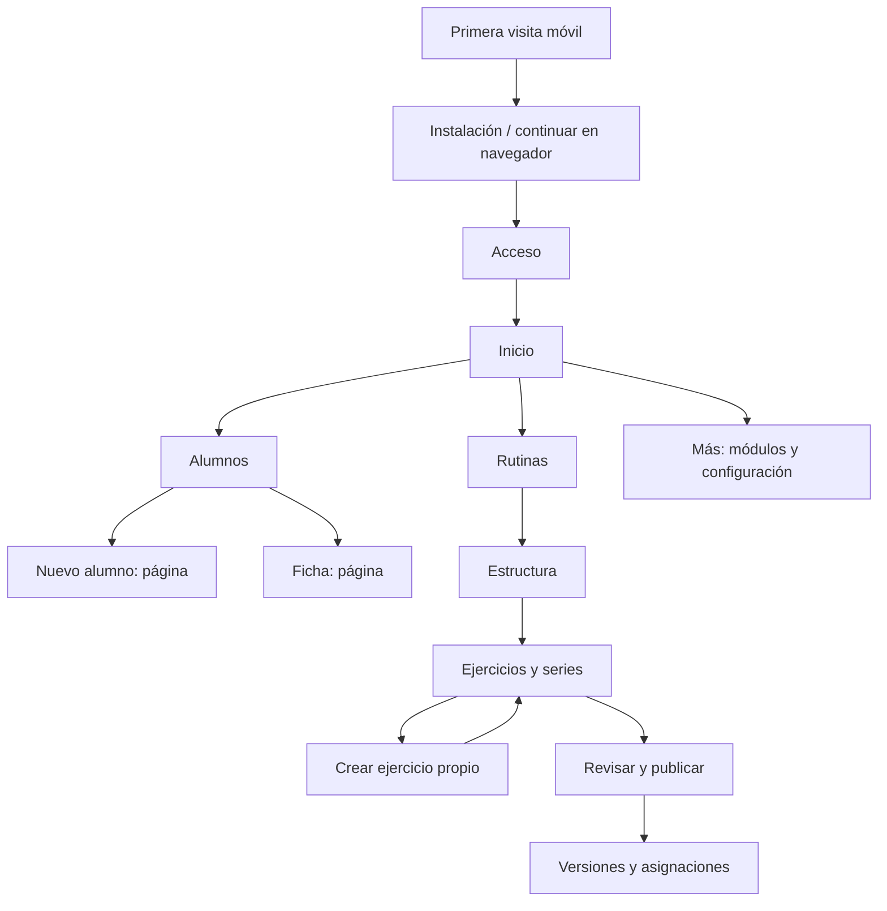

# T15 — Rediseño móvil/PC y autoría del coach

**Corrección de estado 24-10-2026:** tras probar y aportar dos capturas, el usuario rechazó la composición visual y pidió replantear recorridos. [T16](16-ficha-alumno-y-experiencia.md) es la nueva propuesta; los checks técnicos de T15 no equivalen a aceptación de diseño. Este documento conserva el registro histórico de la implementación.

**Actualización 24-10-2026:** el usuario autorizó volver a ejecutar. Build vigente y revisión breve a 320/390/1366 px aprobados; corregidos retorno y encabezado. Demo encendida para prueba manual. [Acta y límites](../evidencias/t15-revision-local.md). Se revoca la pausa de ejecución de este documento; aceptación del usuario, guardados/publicación manuales y teléfonos físicos pendientes.

**23-10-2026 · v0.15.0 de trabajo · esquema 001–024, siguiente 025.** Sigue a la preparación local de T14. Mantiene alcance de coaches independientes y pagos mensuales manuales. Esta tanda responde a las capturas y correcciones del usuario; no abre multicoach ni otro producto.

**Estado:** cambios de código principales implementados, evidencia dirigida de datos disponible; aceptación visual/navegación pendiente. App apagada por petición del usuario. [Decisión](../decisiones/017-redisenio-y-autoria-coach.md), [manual](../runbooks/t15-interfaz-y-contenido.md), [acta](../evidencias/t15-redisenio.md).

## 1. Esquema de experiencia

Las páginas hijas ofrecen retorno visible. Los pasos del constructor se reflejan en la URL. Los cambios sin guardar se conservan al alternar pasos y crear un ejercicio dentro del editor montado; recargar/cerrar no equivale a guardar un borrador. El guardado del borrador continúa siendo explícito.

## 2. Plan visual vigente

| Elemento | Regla |
|---|---|
| Prioridad | Teléfono primero; PC aprovecha anchura sin comprimir tres formularios laterales |
| Fuente | Inter en interfaz y títulos; no titulares de landing en pantallas de trabajo |
| Escala | H1 22 px; H2 17 px; H3 15 px; cuerpo 14 px; etiqueta 13 px; entrada 16 px |
| Anchura | Pantalla útil completa; formularios con límite legible cuando conviene; sin tarjetas vacías que rellenen una columna |
| Espaciado | Laterales móvil 14 px, PC 24 px; panel 14/18 px; separación habitual 8–16 px |
| Forma | Bordes discretos, radios 8–12 px, sin sombras protagonistas |
| Acciones | Una primaria contextual; iconos pequeños con significado; quitar símbolos decorativos de alta y mensajes de ánimo genéricos |
| Scroll | Documento principal; el constructor no tiene paneles verticales independientes ni acciones que tapen campos |
| Navegación | Cinco destinos principales del coach y Más; flecha/texto de retorno en páginas hijas |
| Tacto/teclado | Acciones de 44 px en móvil, campos de 16 px, foco visible; no desactivar el zoom del navegador |
| Instalación | Bienvenida móvil de alto completo con safe areas y salida al navegador; indicaciones específicas para iOS |
| Movimiento | Opcional al solicitarlo, sin autoplay del vídeo; respetar reducción de movimiento para símbolos |

Esta tabla sustituye los titulares grandes, hero y composición de tres columnas previstos en el plan visual inicial. No ocultar errores, controles o datos para conseguir un aspecto limpio.

## 3. Tareas y orden de trabajo

| Ticket | Trabajo | Estado y salida |
|---|---|---|
| T15-01 | Leer capturas, localizar escala, scroll, modales y copy sobrante | Hecho; decisión 017 y este plan |
| T15-02 | Base compacta: tipografía, espacio, barra lateral y navegación principal | Código implementado; pendiente revisión en pantalla |
| T15-03 | Alta/ficha, edición/biblioteca, guías/versiones/fotos y cancelación como páginas | Código implementado; pendiente recorrido Atrás/Adelante |
| T15-04 | Constructor por tres pasos; barra de guardado en el flujo; contenido inicial vacío | Código implementado; pendiente comprobar teclado/scroll y creación anidada |
| T15-05 | Texto libre y opciones propias por espacio; migración, API, RLS y publicación | Implementado y migración aplicada a bases locales; dos casos nuevos aprobados en sus ejecuciones dirigidas |
| T15-06 | Once símbolos SVG opcionales y reproducción de vídeo en bucle | Código implementado; pendiente aceptación gráfica y validación profesional de medios |
| T15-07 | Entrada móvil orientada a instalación, sin bloquear continuar en navegador | Código implementado; instalación física pendiente |
| T15-08 | Sustituir confirmaciones y motivos nativos de la app por revisión dentro de página | Código implementado; caso unitario inicial aprobado; últimos ajustes estáticos no repetidos |
| T15-09 | Actualizar soporte, inventario/backup y guías con límites reales | Documentado; restauración del esquema 024 pendiente antes de uso real |
| T15-10 | Una revisión móvil y una PC; corregir solo el defecto observado | Revisión local dirigida aprobada el 24-10; capturas inspeccionadas. Demo encendida para aceptación del usuario, todavía pendiente |

### T15-02 — Base y pantallas

1. Aplicar `compact.css` después de estilos base.
2. Revisar Inicio, Alumnos, Rutinas y Ejercicios con contenido corto y largo.
3. Mostrar operaciones de negocio y acompañamiento en Más; no perder rutas ni permisos al reducir la barra lateral.
4. En el constructor, activar un solo paso y eliminar altura máxima/scroll vertical de sus paneles.
5. Guardar y publicar dentro del flujo, debajo del contenido. No fijar una barra sobre el formulario.
6. Revisar 320 y 390 px, PC de 1366 × 638 y zoom accesible; ajustar el problema concreto que aparezca.

### T15-03/04 — Navegación y edición

1. Abrir Nuevo alumno como página con nombre, correo y objetivo opcional vacío.
2. Volver a la lista al guardar; entrar de nuevo a una ficha por URL/acción explícita.
3. Crear una rutina con nombre/objetivo vacíos, semana/día estructurales y sin prescripción deportiva sugerida.
4. Seleccionar o crear un ejercicio desde el paso Ejercicios. La creación muestra otra página y conserva el editor montado.
5. Definir series y campos necesarios según unidad; duplicar/reordenar mediante controles existentes.
6. Revisar, guardar borrador o publicar. Publicar conserva validaciones de servidor.
7. Consultar versiones, asignar y abrir guía; volver al punto de trabajo con el retorno visible.
8. Intentar abandonar cambios: revisar la acción dentro de la app y cancelar para seguir editando. Probar también Atrás del navegador cuando se autorice ejecutar.

### T15-05 — Opciones propias

1. El espacio nuevo comienza con cero objetivos/categorías/materiales/ubicaciones guardados.
2. Escribir libremente; no es obligatorio guardar una respuesta para poder usarla.
3. Pulsar Guardar opción para reutilizar cuando el coach quiera incorporarla a su lista.
4. Consultar Mis opciones y elegir una existente; permitir seguir escribiendo otra.
5. Servidor comprueba propietario activo, espacio, límites de longitud y duplicados por campo sin distinguir mayúsculas.
6. Mantener RLS y denegar escritura SQL directa al rol de API. Probar API y SQL con dos espacios sintéticos, no con datos reales.
7. No rellenar nuevos espacios con estas respuestas ni copiar listas de otros coaches.
8. Mantener límites operativos existentes: 300 opciones por campo, longitudes y topes de semanas/días/series. Cualquier ampliación posterior requiere revisar coste y validación.

### T15-06 — Plan de ilustraciones y medios

1. Identificación inicial: banco/press, sentadilla, bisagra, remo, press vertical, zancada, dominada, curl, polea, plancha y bicicleta. Todos son opcionales y ninguno se asigna por inferencia del nombre.
2. Una sola geometría SVG: línea redondeada, proporciones comunes, equipo con acento de marca y figura con color de texto.
3. Dos poses con activación explícita ofrecen una referencia visual ligera. No describirlas como un GIF profesional o una explicación completa de técnica.
4. Para el ejercicio concreto, el coach escribe indicaciones y añade su imagen o clip autorizado. El nombre libre permite cualquier variante sin esperar un icono nuevo.
5. Los clips existentes se reproducen con controles, `playsinline`, bucle y sin autoplay. No asegurar que un GIF subido conserve animación después del procesamiento de imágenes.
6. Antes de ampliar: un coach valida cada medio, recorrido y nombre; registrar procedencia, autorización, fecha/revisión y si es demostración o identificación.
7. Priorizar los movimientos realmente usados. No descargar cientos de imágenes ni montar un servicio externo sin necesidad y presupuesto aprobados.
8. Una animación instructiva futura necesita poses intermedias, secuencia y revisión del profesional. Mantener símbolo neutro/texto si no existe una referencia adecuada.

## 4. Revisión pendiente de bajo consumo

**Recorrido dirigido ejecutado el 24-10-2026 tras autorización del usuario; reutilizar su evidencia.** La lista siguiente conserva el procedimiento. No repetir la ejecución completa para abrir la demo.

1. Revisar primero los cambios posteriores al último build con análisis estático dirigido.
2. Cuando el usuario pida volver a probar, hacer una sola compilación del estado final y arrancar únicamente la demo ficticia.
3. Un navegador, una página reutilizada, sin workers de medios/PDF ni suite histórica.
4. Visita móvil: instalación primero → continuar → acceso → nuevo alumno sin objetivo prefijado.
5. PC: rutina con pasos anchos, sin columnas con scroll interno; crear ejercicio propio, volver y conservar datos.
6. Confirmación: cancelar salida conserva cambios; confirmar salida los descarta. Verificar que ninguna operación se ejecuta por evaluar una Promise como verdadera.
7. Guardar como máximo dos capturas útiles y medidas de desborde; no generar una matriz completa.
8. Detener la demo. Registrar resultado y límites en el acta; no cerrar teléfonos reales ni recuperación externa por este recorrido local.

## 5. Criterio de terminado

- Recorrido principal aceptado por el usuario en móvil y PC con contenido propio.
- Sin ventanas modales de la app, scrolls internos del constructor o controles superpuestos.
- Objetivos/categorías no impuestos; permisos y aislamiento del guardado de opciones acreditados.
- Datos/versiones previos conservados; firma NAVZ visible en los lugares previstos.
- Instalación y vídeos comprobados en dispositivos reales antes de piloto.
- Guías, capturas y evidencias describen lo realmente ejecutado. Actualmente **T15 no cumple todavía todos estos criterios**.
